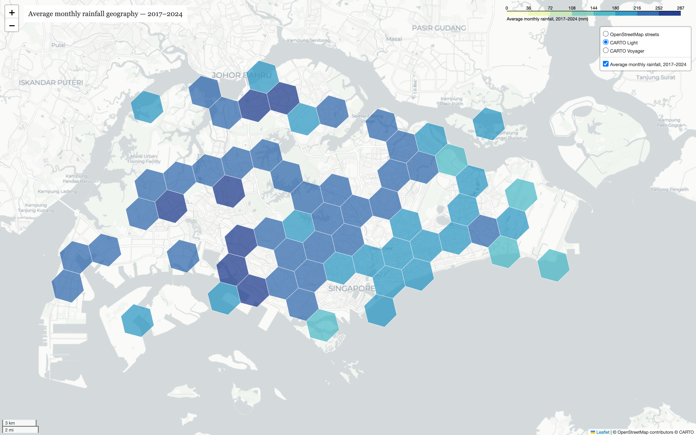

# Singapore Rainfall Analysis and Prediction

**DSA5208 — Scalable Distributed Computing for Data Science**<br>
National University of Singapore

This project analyses five-minute rainfall observations from gauges across
Singapore between 2017 and 2024. Apache Spark and PySpark provide the shared
processing layer for cleaning, temporal feature engineering, exploratory
analysis, rainfall prediction, and comparisons of local, Spark Standalone,
and Docker execution.

<p align="center">
  
</p>

<p align="center"><em>Gauge-supported H3 choropleth of average monthly rainfall, 2017–2024.</em></p>

The final submission is
[`output/Historical_Rainfall_Singapore_Report.docx`](output/Historical_Rainfall_Singapore_Report.docx).

## Table of contents

1. [Project scope](#project-scope)
2. [Repository structure](#repository-structure)
3. [Requirements](#requirements)
4. [Required raw data](#required-raw-data)
5. [Complete sequential run](#complete-sequential-run)
6. [Outputs and run tracking](#outputs-and-run-tracking)
7. [Method summary](#method-summary)
8. [Supporting documentation](#supporting-documentation)

## Project scope

| Stage | Purpose | Main outputs |
|---|---|---|
| Data preparation | Combine annual files, standardise timestamps and stations, reject invalid readings, and remove duplicates | Clean Parquet and audit tables |
| Task 1 EDA | Measure annual, seasonal, monthly, diurnal, and heavy-rain patterns | PNG figures and CSV tables |
| Geospatial EDA | Map gauge coverage, H3 rainfall patterns, August comparisons, annual change, and planning-region summaries | Folium HTML, GeoJSON, PNG, and CSV outputs |
| Task 2 prediction | Estimate whether rainfall in the next 30 minutes exceeds a selected threshold | Saved models, temporal test metrics, and point predictions |
| Systems study | Compare model behaviour and runtime across local, Spark Standalone, and Docker configurations | Benchmark tables, heatmaps, and scaling figures |

The model and compute registries follow the `mainline` implementation. They
contain six Spark MLlib models—GBT, Random Forest, Logistic Regression, Linear
SVC, Multilayer Perceptron, and Factorization Machines—and two supplementary
PyTorch sequence models, LSTM and TCN.

## Repository structure

```text
scalabeDistributeRainfall/
├── assets/                         # NUS branding and report assets
├── cluster/                        # Spark Standalone launch scripts
├── data/
│   ├── raw/                        # rainfall_2017.csv ... rainfall_2024.csv
│   ├── processed/                  # generated Parquet datasets
│   └── singapore_map_bounary/      # planning-region boundary GeoJSON
├── docker/                         # Dockerized Spark cluster
├── models/                         # fitted models and metadata
├── output/
│   ├── Historical_Rainfall_Singapore_Report.docx
│   ├── figures/geospatial/         # report-ready geographic PNGs
│   ├── interactive/                # interactive Folium maps
│   ├── geojson/                    # generated geographic layers
│   ├── tables/                     # analysis and benchmark tables
│   └── runs/                       # timestamped tracked runs
├── src/
│   ├── clean_data.py
│   ├── task1_explore.py
│   ├── build_spatiotemporal_features.py
│   ├── geospatial/                 # Task 1 map scripts
│   ├── task2_*.py                  # Task 2 feature/model scripts
│   ├── models/                     # mainline model registry
│   └── compute/                    # mainline compute registry
├── requirements.txt
└── README.md
```

## Requirements

- Python 3.9 or later
- Java 17 or 21 available through `java` or `JAVA_HOME`
- Git LFS when obtaining raw data from Git
- Docker with the Compose plugin for container experiments
- Chromium installed through Playwright for PNG map rendering
- At least 16 GB RAM and enough disk for approximately 7.8 GB of raw CSVs,
  generated Parquet, model artifacts, and Spark temporary data

The recorded Spark environment uses PySpark 3.5.3. Run the commands below from
the repository root in one terminal session.

NumPy is kept below version 2 because some PyTorch builds used by the mainline
LSTM/TCN experiment were compiled against the NumPy 1.x interface.

## Required raw data

> **Raw data must be supplied before the pipeline is run.** Submission archives
> may omit the CSV files because they occupy several gigabytes. Confirm that
> `data/raw/` contains the eight complete files `rainfall_2017.csv` through
> `rainfall_2024.csv`. A small Git LFS pointer is not the dataset, and the
> cleaning, analysis, mapping, and modelling stages will not run without the
> full files.

Source: [data.gov.sg — Historical Rainfall across Singapore](https://data.gov.sg/collections/2279/view),
collection 2279, published by Singapore's National Environment Agency.

The annual files use these columns:

```text
date, timestamp, update_timestamp, station_id, station_name,
station_device_id, location_longitude, location_latitude,
reading_update_timestamp, reading_value, reading_type, reading_unit
```

Only `rainfall_<year>.csv` is accepted as the canonical filename. Do not keep a
second `HistoricalRainfall...` copy.

## Complete sequential run

The numbered blocks below reproduce the implemented preparation, EDA,
geospatial analysis, model study, and architecture experiments. Full-data
Spark stages can take substantial time.

### 1. Clone and install

```bash
git clone https://github.com/AmritSatpathy/scalabeDistributeRainfall.git
cd scalabeDistributeRainfall

python3 -m venv .venv
./.venv/bin/python -m pip install --upgrade pip
./.venv/bin/python -m pip install -r requirements.txt
./.venv/bin/python -m playwright install chromium

mkdir -p .cache/matplotlib output/tables
export MPLCONFIGDIR="$PWD/.cache/matplotlib"
```

If the repository is already cloned, start with `cd`, reuse or create `.venv`,
and install the requirements.

### 2. Acquire and verify the raw CSVs

Use either Git LFS or the public download script:

```bash
# Option A: retrieve the tracked large files
git lfs install
git lfs pull --include="data/raw/rainfall_*.csv"

# Option B: download all annual files from data.gov.sg
# Use this instead of Option A when the submission does not contain the CSVs.
./.venv/bin/python src/download_data.py \
  --years 2017 2018 2019 2020 2021 2022 2023 2024 \
  --force
```

After using one option, verify that all eight files contain data rather than
LFS pointers:

```bash
for year in 2017 2018 2019 2020 2021 2022 2023 2024; do
  file="data/raw/rainfall_${year}.csv"
  if [ ! -f "$file" ] || [ "$(wc -c < "$file")" -lt 1000000 ]; then
    echo "ERROR: $file is missing or is only a Git LFS pointer"
    exit 1
  fi
done
echo "All raw rainfall CSVs are present."
```

### 3. Validate, clean, and build shared spatiotemporal features

```bash
./.venv/bin/python src/validate_feature_contract.py

./.venv/bin/python src/clean_data.py \
  --years 2017 2018 2019 2020 2021 2022 2023 2024 \
  --max-5min-mm 60 \
  --grid-tolerance-seconds 60 \
  --hash-mode full \
  --publish-legacy

./.venv/bin/python src/build_spatiotemporal_features.py \
  --profile minimal \
  --forecast-stride-minutes 15 \
  --wet-threshold-mm 0 \
  --shuffle-partitions 192 \
  --output-partitions 96 \
  --station-buckets 4 \
  --hash-mode metadata
```

Cleaning publishes `data/processed/rainfall_clean`. The compact feature stage
supports the time-aware geographic analysis while keeping workstation runtime
practical.

### 4. Run Task 1 statistical and geospatial EDA

```bash
# Standard annual, monthly, seasonal, diurnal, station, and event analysis
./.venv/bin/python src/task1_explore.py \
  --daily-completeness 0.95 \
  --stable-year-coverage 0.90 \
  --hash-mode full \
  --publish-legacy

# Feature-aware geographic analysis
./.venv/bin/python src/geospatial/task1_geospatial.py \
  --daily-completeness 0.90 \
  --h3-resolution 7 \
  --minimum-event-stations 20 \
  --hash-mode metadata \
  --publish-legacy

# Create the common coverage-qualified station-month table
./.venv/bin/python src/geospatial/task1_geospatial_choropleths.py \
  --daily-completeness 0.90 \
  --minimum-eligible-days 20 \
  --h3-resolution 7 \
  --publish-legacy

# Active gauges, August/annual rainfall, and 2017-to-2024 change
./.venv/bin/python src/geospatial/task1_august_geospatial_maps.py \
  --monthly-summary output/tables/geo_station_month_summary.csv \
  --render-png \
  --publish-legacy

# Comparable August 2017, 2018, 2023, and 2024 maps
./.venv/bin/python src/geospatial/task1_august_year_maps.py \
  --monthly-summary output/tables/geo_station_month_summary.csv \
  --years 2017 2018 2023 2024 \
  --render-png \
  --publish-legacy

# Long-period H3 and official planning-region summaries
./.venv/bin/python src/geospatial/task1_long_period_average_map.py \
  --monthly-summary output/tables/geo_station_month_summary.csv \
  --render-png \
  --publish-legacy

./.venv/bin/python src/geospatial/task1_region_monthly_choropleth.py \
  --monthly-summary output/tables/geo_station_month_summary.csv \
  --render-png \
  --publish-legacy

# August 2024 and complete-2024 planning-region maps
./.venv/bin/python src/geospatial/task1_region_2024_choropleths.py \
  --monthly-summary output/tables/geo_station_month_summary.csv \
  --year 2024 \
  --focus-month 8 \
  --render-png \
  --publish-legacy
```

Folium can use OpenStreetMap without a key. CARTO layers can be enabled with an
untracked `basemaps.local.json` in the project root:

```json
{
  "carto": {
    "api_key": "YOUR_CARTO_BASEMAP_KEY"
  }
}
```

### 5. Build Task 2 features, train the canonical model, and predict

These commands retain the `mainline` feature and training behaviour.

```bash
# Materialise expensive per-station temporal windows once
./.venv/bin/python src/task2_build_features.py

# Canonical Spark MLlib Gradient-Boosted Trees model
./.venv/bin/python src/task2_train.py \
  --model gbt \
  --compute local-all \
  --test-year 2024 \
  --max-train-rows 8000000

# Example inference query using the saved canonical model
./.venv/bin/python src/task2_predict.py \
  --station S77 \
  --time "2024-06-15T14:00:00" \
  --threshold 1.0
```

Task 2 trains on years before 2024 and evaluates on 2024. The threshold is a
model input, allowing one fitted pipeline to answer multiple rainfall amounts.

### 6. Run the complete mainline model comparison

```bash
# Confirm the registered model and compute names
./.venv/bin/python src/task2_train.py --list

# Six Spark MLlib models on the common local-all configuration
./.venv/bin/python src/benchmark.py \
  --models gbt rf logreg linsvc mlp fm \
  --computes local-all \
  --sample-fraction 0.15 \
  --max-train-rows 1000000

# Supplementary sequence models; CPU works but a compatible GPU is faster
./.venv/bin/python src/task2_deep.py --model lstm --epochs 8
./.venv/bin/python src/task2_deep.py --model tcn --epochs 8

# Model-comparison figures
./.venv/bin/python src/benchmark_plot.py \
  --results output/tables/benchmark_results.csv
```

Install the PyTorch build appropriate for the machine when GPU execution is
required. LSTM/TCN are supplementary because their feature representation and
hardware differ from the MLlib experiment.

### 7. Run the mainline compute-configuration study

The commands below use the mainline architecture names and the same capped GBT
workload. Local, Standalone, and Docker all run on the same physical host.

```bash
# Start a fresh architecture-results table
COMPUTE_CSV="output/tables/benchmark_compute.csv"
rm -f "$COMPUTE_CSV"

# Local Spark scaling
./.venv/bin/python src/benchmark.py \
  --models gbt \
  --computes local-2 local-4 local-8 local-all \
  --sample-fraction 0.15 \
  --max-train-rows 1000000 \
  --benchmark-csv "$COMPUTE_CSV"

# Spark Standalone with four worker JVMs
cluster/start_standalone.sh 4 2 3g
export SPARK_MASTER_URL="spark://localhost:7077"
./.venv/bin/python src/benchmark.py \
  --models gbt \
  --computes standalone-2x2 standalone-4x2 \
  --sample-fraction 0.15 \
  --max-train-rows 1000000 \
  --benchmark-csv "$COMPUTE_CSV"
cluster/stop_standalone.sh

# Docker: mainline four-model sweep on two-worker and three-worker layouts
docker compose -f docker/docker-compose.yml up -d --build --scale spark-worker=2
docker/run_sweep.sh docker-2w

docker compose -f docker/docker-compose.yml up -d --scale spark-worker=3
docker/run_sweep.sh docker-3w
docker compose -f docker/docker-compose.yml down

# Architecture-comparison figures
./.venv/bin/python src/benchmark_plot.py \
  --primary-compute local-all \
  --results "$COMPUTE_CSV" \
  --suffix _compute_reproduction
```

The mainline Docker helper evaluates GBT, Random Forest, Logistic Regression,
and Linear SVC at each worker count and appends the recovered container results
to `output/tables/benchmark_compute.csv`.

### 8. Inspect tracked pipeline artifacts

```bash
./.venv/bin/python src/run_artifacts.py --latest clean
./.venv/bin/python src/run_artifacts.py --latest spatiotemporal_features
./.venv/bin/python src/run_artifacts.py --latest task1
./.venv/bin/python src/run_artifacts.py --latest task1_geospatial
```

## Outputs and run tracking

| Artifact | Location |
|---|---|
| Clean observations | `data/processed/rainfall_clean/` |
| Task 2 temporal features | `data/processed/features_base/` |
| Standard EDA figures | `output/figures/` |
| Geographic PNG figures | `output/figures/geospatial/` |
| Interactive Folium maps | `output/interactive/` |
| Geographic layers | `output/geojson/` |
| Analysis and model tables | `output/tables/` |
| Fitted models | `models/` |
| Immutable tracked stages | `output/runs/<timestamp>_<stage>_<hash>/` |

Tracked cleaning and analysis stages record their command, parameters, Git
state, input fingerprints, source hashes, upstream artifacts, and output
hashes. Stable paths under `output/` and `data/processed/` are convenient
published copies; the timestamped run is the provenance record.

## Method summary

- **Cleaning:** timestamps are interpreted in `Asia/Singapore`; rainfall and
  coordinates are cast to numeric values; invalid observations are removed;
  corrected station-time records are de-duplicated.
- **Coverage control:** station-month and region-month summaries reduce bias
  caused by changes in gauge availability.
- **Geography:** paired maps share colour scales, and H3 polygons are displayed
  only where gauges provide evidence.
- **Prediction:** recent accumulation, rolling history, time cycles, station
  identity, location, and rainfall threshold feed a 30-minute-ahead classifier.
- **Temporal evaluation:** earlier years train the model and 2024 is held out;
  random row splitting is not used for the principal result.
- **Systems interpretation:** Standalone and Docker introduce separate
  processes and network shuffle, but they share one host's CPU, memory, disk,
  and network. Results measure deployment overhead rather than multi-machine
  scalability.

## Supporting documentation

| Document | Purpose |
|---|---|
| [`project_assignment_guidelines.md`](project_assignment_guidelines.md) | Assignment requirements |
| [`SPATIOTEMPORAL_PIPELINE_RUNBOOK.md`](SPATIOTEMPORAL_PIPELINE_RUNBOOK.md) | Detailed preprocessing and geographic workflow |
| [`TIME_SERIES_PREDICTION_PLAN.md`](TIME_SERIES_PREDICTION_PLAN.md) | Time-series and geospatial modelling plan |
| [`src/geospatial/README.md`](src/geospatial/README.md) | Geospatial scripts and outputs |
| [`cluster/README.md`](cluster/README.md) | Spark Standalone deployment |
| [`docker/README.md`](docker/README.md) | Docker Spark deployment |
| [`RATIONALE.md`](RATIONALE.md) | Design decisions and interpretation |
| [`output/Rainfall_Report_Gap_Analysis.md`](output/Rainfall_Report_Gap_Analysis.md) | Report review record |
| [`output/Architecture_Diagram_Specification.md`](output/Architecture_Diagram_Specification.md) | Architecture figure specification |
