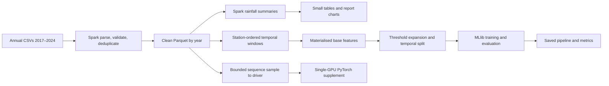

# Rainfall report — gap analysis and improvement plan

**Review date:** 15 October 2026 · **Verdict:** promising Spark project; report needs evidence reconciliation before submission.

| Review scope | Basis |
|---|---|
| Primary assessment | [Assignment guidelines](../project_assignment_guidelines.md) and [submitted-report draft](Historical_Rainfall_Singapore_Report.docx), assessed as a standalone academic report |
| Supporting verification | Local CSV results, model metadata, figures, feature/inference code, and compute configurations; these inform findings but do not substitute for evidence inside the report |
| Layout inspection | Existing DOCX rendered to 18 PDF pages; all page previews inspected. Page references below refer to this LibreOffice rendering and may differ in Word |
| Verification limit | No rainfall pipeline, training, or benchmark was rerun. Agreement with a CSV confirms artifact consistency, not experimental reproducibility |
| Submission discrepancy | You requested document-only assessment. The supplied guidelines explicitly require **source + README, trained model, and PDF with names/IDs**, due **18 October 2026**. Treat document-only submission as a course clarification to confirm; this review does not override the written requirements |
| Changes made | This analysis file only. The existing DOCX and implementation are preserved |

## 1. Rating and immediate decision

**Indicative rating: 58/100.** Reviewer-defined weights, not an official marking rubric or predicted grade. Scores reflect what the current report establishes, with inconsistencies exposed by supporting artifacts.

| Assessment dimension | Weight | Score | Main reason |
|---|---:|---:|---|
| Assignment coverage | 15 | 12 | Both tasks, environment, AI use and limitations covered; several requested findings remain instructions to add evidence |
| Data cleaning and Task 1 | 15 | 10 | Useful annual analysis; missing embedded seasonal/spatial plots and completeness audit |
| Prediction methodology and evaluation | 20 | 13 | Appropriate MLlib model and temporal holdout; calibration absent, window and inference concerns unresolved |
| Distributed architecture explanation | 15 | 8 | Real Spark executors demonstrated; no architecture diagram, bottleneck analysis or measured multi-node evidence |
| Systems experiment quality | 15 | 5 | Core counts, memory, partitions and samples differ; one timing per configuration |
| Result traceability | 10 | 4 | Different model runs mixed; no unambiguous mapping from final model to tables and figures |
| Presentation and standalone readiness | 10 | 6 | Consistent colours and hierarchy; large layout gaps, draft instructions and repeated tables |
| **Total** | **100** | **58** | **Revise before submission** |

| Question | Assessment |
|---|---|
| Is the architecture meaningful? | **Yes, as a batch Spark pipeline and single-host deployment study.** CSV → cleaned Parquet → materialised temporal features → MLlib → evaluated probabilities is coherent |
| Does it demonstrate scale-out? | **No.** Multiple executor processes/containers share one laptop; additional physical compute/storage/network capacity was not tested |
| Is Spark academically justified? | Yes: the assignment requires it, and window sorts, repeated training, and millions of rows provide useful systems workloads. Dataset size alone does not prove Spark is necessary or faster |
| What should distinguish the project? | Correct temporal processing **plus** measured partitioning, resource and reuse trade-offs; make every performance claim explainable |
| Should more models be added? | Low priority. GBT, logistic regression and persistence already support a strong core study; retain other models as supplementary evidence |

## 2. Requirement-to-evidence matrix

| Requirement | Current report evidence | Gap | Concrete improvement |
|---|---|---|---|
| Use 2017–2024 data | §§2, 4; annual table | Data provenance and exclusion counts incomplete | Add annual raw/clean/eligible counts and dataset identifiers |
| Explain cleaning | §3 lists rules | No rule-level counts; extreme-event decision unresolved | Add sequential audit counts, cadence/missingness checks and outlier sensitivity |
| Explore within-year patterns | §§4.2–4.3 describe seasonality/diurnal results | Actual plots omitted | Embed existing monthly and diurnal figures; state denominator and numerical finding |
| Explore across-year patterns | Annual rainfall and heavy-rain plots | Station composition and valid days vary | Compare stable station cohort; normalise heavy days by valid station-days |
| Predict probability from station/time/threshold | §§5.1–5.3; clear target | Arbitrary-threshold and operational timing not validated | Define supported thresholds, observation availability and stale-data behaviour |
| Select features and use Spark MLlib | Feature table and GBT pipeline | Hyperparameters and ablation missing | Add parameter table and persistence/calendar/recent-rain ablation |
| Evaluate predictive performance | ROC/PR metrics and threshold table | Mixed runs; no probability calibration | One canonical evaluation, prevalence, positive-class metrics and reliability diagram |
| Describe compute environment | §§2.2–2.3 | Missing actual resources and execution plan | Add measured executor topology, memory/partitions, storage and Spark UI evidence |
| Discuss results and limitations | §§6–7 | Overhead explanation not experimentally isolated | Matched-resource comparisons with repeats and stage metrics |
| Declare AI usage | §8 | Kiro-only declaration may no longer be complete | Accurately include this AI-assisted review and any subsequent editing; retain human verification responsibility |
| Identify group members | Cover table | Names/IDs are placeholders | Complete actual member details; remove unused row |

## 3. Highest-priority evidence repairs

**P0 = resolve before relying on results; P1 = high-value academic improvement; P2 = optional extension.**

| Priority | Finding and location | Evidence | Required action |
|---|---|---|---|
| P0 | Mixed GBT evaluation runs, §§5–6 | Main benchmark: 7,998,681 train / 1,592,090 test; metadata: 7,997,496 / 31,872,380 | Select and identify the final run; regenerate its complete table/figure set together |
| P0 | Headline and per-threshold metrics have different provenance | Headline 0.925/0.586 follows benchmark CSV; GBT threshold values match saved metadata/general threshold CSV | Separate benchmark and final-model evaluations explicitly; never combine them as one test |
| P0 | Mutable metric files | `model_metrics_overall_gbt.csv` reports 0.923908/0.574482; general file reports 0.924497/0.584145 | Use immutable run IDs; current trainer writes metric CSVs even with `--no-save` |
| P0 | Missing-plots statements are stale, §§4.2–4.4 | All six cited monthly, diurnal and spatial PNGs exist under `output/figures/` | Inspect and embed them after provenance checks; replace “not attached” paragraphs with findings |
| P0 | F1 definition unresolved, §5.5 | MLlib evaluator uses `metricName="f1"`; deep-model helper computes positive-class F1 | Label Spark value as weighted F1; calculate positive-class F1 separately; avoid cross-framework F1 comparison until harmonised |
| P0 | Compute samples are not identical | GBT train counts: 999,587 / 1,000,314 / 1,000,771; test counts also differ | Freeze row identities once; share the same persisted sample across deployments |
| P1 | Docker benchmark provenance needs confirmation | Several Docker/Standalone rows have identical sample counts and all recorded quality metrics; timestamps/formats differ | Link each row to its original application/event log. This is a verification trigger, **not proof of invalid results** |
| P1 | Cleaning total has supporting evidence | Annual CSV counts sum to **48,538,713**, matching the report | Retain total with source; still obtain before/after counts and eligibility losses |
| P1 | Hyperparameters already available | GBT: 40 iterations, depth 5, step 0.1, 128 bins, subsampling 0.7, seed 42, node-ID cache enabled | Include as implementation settings; verify they match the selected saved run |

| GBT artifact | Train rows | Test rows | ROC-AUC | PR-AUC | Appropriate use |
|---|---:|---:|---:|---:|---|
| `tables/benchmark_results.csv` | 7,998,681 | 1,592,090 | 0.92517 | 0.58619 | Model-comparison run |
| `../models/model_metadata.json` | 7,997,496 | 31,872,380 | 0.924497 | 0.584145 | Candidate final-model record; verify against saved model |
| `tables/model_metrics_overall.csv` | Not recorded | Not recorded | 0.924497 | 0.584145 | Agrees with metadata metrics |
| `tables/model_metrics_overall_gbt.csv` | Not recorded | Not recorded | 0.923908 | 0.574482 | Agrees with Standalone 4×2 benchmark metrics; run mapping still needed |

## 4. Correctness gaps that affect report credibility

These are static-code findings or risks, **not measured estimates of their effect on accuracy**. Explain the resolution and resulting evidence in the report; merely changing prose cannot repair affected results.

| Priority | Finding | Why it matters | Fix and report evidence |
|---|---|---|---|
| P0 | Inclusive backward windows: `rangeBetween(-1800,0)` | On a regular grid, includes seven five-minute totals, representing 35 minutes rather than six totals | Define interval semantics; for interval-ending readings use `(t−30 min,t]`. Demonstrate six known readings and update affected training/inference consistently |
| P0 | `lag(...,1)` means previous row, not necessarily t−5 minutes | Missing timestamps can turn a five-minute lag into a much older observation; deep sequences have the same issue | Validate cadence or join exact timestamps; add missing-history indicators and gap policy |
| P0 | Future completeness checks only `future_n >= 6` | Six observations guarantee the intended six slots only if timestamps are unique and on the expected grid | Validate all six offsets; report irregular cadence, missing windows and excluded rows |
| P0 | Features/labels built before year split | Final 2023 training labels can include early-2024 observations | Keep training rows only when target-window end is before split; preserve valid historical context for test features |
| P0 | Feature output drops timestamp | Only station/year and features remain; exact boundary purge and stable sample IDs become difficult | Retain `(station_id, ts)`, label-end timestamp, quality flags and feature version |
| P0 | Inference dry-spell context differs from training | Training searches all preceding rows, capped at 24h; inference reads only 6h. Rain 10h ago becomes 1440 minutes at inference, versus 600 in training | Share one feature contract; retrieve 24h history or equivalent last-wet state; compare offline/online feature values |
| P0 | Requested time can differ from scored time | Inference selects latest prior observation and uses its calendar/history; a stale row shifts the effective forecast origin | Require exact supported time or explicitly construct query-time features with staleness policy; show returned forecast origin |
| P1 | Latest corrected readings used retrospectively | Correction/update availability may differ from what was known at prediction time | Declare retrospective setting; if claiming live applicability, evaluate an as-of-availability policy |
| P1 | Probability quality not established | ROC/PR measures ranking; high accuracy/weighted F1 can hide missed rare events | Report Brier/log loss, reliability bins with counts, prevalence, confusion matrix and positive precision/recall |
| P1 | Threshold response unconstrained | A model accepting numeric q does not guarantee decreasing P(rain > q) | Test unseen q = 0.5, 3, 7 mm and monotonicity violations across an ordered threshold grid |
| P1 | Deep-model metric implementation differs | Manual ROC helper does not actually average tied ranks; PR integration and F1 differ from MLlib path | Use shared score files and one validated evaluator; include tie-case checks before ranking frameworks |

Spark's evaluator history identifies weighted F1, while the API provides separate per-label metrics: [Apache evaluator issue](https://issues.apache.org/jira/browse/SPARK-7690), [Spark 3.5.6 evaluator API](https://spark.apache.org/docs/3.5.6/api/python/reference/api/pyspark.ml.evaluation.MulticlassClassificationEvaluator.html). The latter is a nearby 3.5 patch reference, not evidence that the project ran 3.5.6.

## 5. Architecture: retain, explain and improve

**Observed logical pipeline.** Spark runs locally or through Standalone/Docker executors on one host; the GPU branch is not distributed training. Add a separate physical diagram showing the host/WSL boundary, driver, master, executor JVMs, shared disk and shuffle arrows.

| Component | What is good | Limitation | Improvement worth explaining |
|---|---|---|---|
| Spark DataFrame processing | Distributed operators for parsing, aggregates and windows | No operator-level cost evidence | Annotate stages with rows, bytes, duration, shuffle and spill |
| Year-partitioned Parquet | Reusable columnar data; year filtering | `repartition("year")` before clean write concentrates eight years into at most eight occupied shuffle partitions | Compare file sizes/write tasks; separate directory partitioning from execution partitioning |
| Station temporal windows | Time-range sums avoid borrowing distant readings into sums | Window distribution by only ~91 station keys limits useful concurrency and can create large tasks | Measure task skew; evaluate station/time blocks with correct overlapping context |
| Feature materialisation | Avoids repeated window computation across models | Benefit not quantified; feature lineage incomplete | Record build/read cost and break-even number of model fits |
| Threshold expansion | One model supports query threshold | Fivefold row growth increases memory/work; rows are correlated copies | Sample stable base contexts before expansion; keep all thresholds per context; quantify accuracy versus cost |
| Broadcast station table | Suitable for small station metadata | Time-varying station locations may be flattened | Validate relocations; use effective dates if necessary |
| `MEMORY_AND_DISK` | Can spill when data exceed memory | Spill/GC and host memory contention unmeasured | Record executor metrics; reserve memory for OS, driver and Python processes |
| Standalone/Docker | Useful deployment demonstration | Same-host shared disk, network and CPU; worker advertised memory is not a container hard limit | Record actual executor allocation and enforced limits, not just requested settings |
| Multi-machine extension | Pipeline can be adapted | Local paths/bind mounts are not shared multi-node storage | Proposed shared object store/HDFS, accessible driver, identical dependencies and event-log storage; label as untested |
| GPU branch | Useful supplementary modelling exploration | `toPandas()` bounds scale at driver memory; different features/data counts | Report preparation, transfer and inference costs separately; use common evaluation contexts |

| Config in source | Intended CPU capacity | Driver heap | Executor heap | Shuffle partitions |
|---|---:|---:|---:|---:|
| local-all | 16 threads on reported host | 20 GB | Same local JVM | 96 |
| standalone-2x2 | 4 cores | 4 GB | 2 × 2 GB | 32 |
| standalone-4x2 | 8 cores | 4 GB | 4 × 2 GB | 64 |
| docker-2w | 4 cores | 2 GB | 2 × 1 GB | 32 |
| docker-3w | 6 cores | 2 GB | 3 × 1 GB | 48 |

These are **source configuration values, not verified runtime allocations**. Core capacity, total heap and partition count all change; current timing differences cannot be attributed solely to container/network overhead. Docker Compose advertises 2 cores/3 GB per worker but does not set container CPU/memory hard limits.

## 6. Experiments that can make this project stand out

**Recommended contribution:** “Correct and efficient temporal rainfall processing under limited compute: window integrity, partitioning and feature reuse.” Start with E1–E3; add E4/E5 after correctness and provenance are settled.

| ID / priority | Research question | Controlled design | Evidence to put in report | Effort |
|---|---|---|---|---|
| E1 / P1 | What is deployment overhead at equal resources? | Same persisted sample, 4 compute cores, same memory budget/partitions/model; local[4] vs 2×2 Standalone vs 2×2 Docker | Median runtime and range, stage breakdown, realised CPU/memory; acknowledge JVM memory-layout differences | Medium |
| E2 / P1 | Does more parallelism help this workload? | Fixed dataset and memory budget; local[1/2/4/8], then fixed-core executor layouts separately | Speedup, efficiency, throughput and task/GC/spill explanation | Medium |
| E3 / P1 | When does materialising features pay off? | Same feature definitions and jobs; recompute per fit vs build once/reuse; test 1, 3, 6 fits | Total elapsed time including build and I/O; measured break-even point | Low–medium |
| E4 / P1 | Can temporal partitioning improve performance without changing answers? | Station-only windows vs station-month blocks with overlap; same exact input and output keys | Feature/label equality check, runtime, p95 task duration, shuffle/spill, boundary-error count | High; strongest distinctive study |
| E5 / P1 | Does less training data preserve useful probability quality? | Fixed held-out set; 0.25/1/4/8M expanded training rows with stable nested base samples; GBT fixed | PR-AUC and Brier versus runtime/memory; show uncertainty and prevalence | Medium |
| E6 / P1 | Is model skill more than rainfall persistence? | Persistence and prevalence baselines; calendar-only vs +recent rain vs +station/location; common split | Per-threshold PR-AUC/Brier and positive recall; validation-selected cutoff | Medium |
| E7 / P2 | Does Spark recover correctly after executor loss? | Test job only; controlled executor stop during a long action; compare uninterrupted run; at least three repeats | Recovery overhead, retried tasks and output equality; distinguish worker loss from host failure | Medium |
| E8 / P2 | Does adding machines improve capacity? | Only if independent nodes are available: 1/2/4 identical nodes; fixed data for strong scaling, data proportional to nodes for weak scaling | Speedup/efficiency, throughput, network/storage cost, observed failure/OOM limits | High; do not claim from containers |

| E4 correctness requirement | Implementation/design condition |
|---|---|
| Rolling features and target | Each station-month core block must see at least 180 minutes of prior context and 30 minutes of future context |
| Dry-spell feature | Also carry last-wet state or up to 24h look-back; 180 minutes alone is insufficient |
| Output ownership | Emit only rows whose timestamp belongs to the block's core interval; discard duplicate halo outputs |
| Integrity checks | Compare keys, counts, labels and all features against corrected station-only reference; include month/year boundaries and missing-slot cases |
| Sampling | Compute temporal features before arbitrary row sampling; otherwise sampling destroys history |
| Interpretation | This is a proposed experiment, not a guaranteed optimisation. Overlap/I/O can outweigh parallelism gains |

| Benchmark control | Minimum defensible protocol |
|---|---|
| Frozen inputs | Preserve station/time IDs and data/feature checksum; identical train and test membership across configurations |
| Repetitions | One separately labelled warm-up and at least three measured runs per setting; randomise order and report all timings plus median/range |
| Timing boundaries | Separately time read, clean, windows, expansion, fit, scoring and evaluation; distinguish cached fit timing from end-to-end time |
| Lazy execution | Force the intended output computation before stopping a timer; inspect the executed plan/cache state |
| Resource observations | Actual executor count/cores, driver/executor heap, process memory, GC, shuffle read/write, spill and p50/p95 task time |
| Cache policy | Define warm/cold application cache; do not label fresh Spark sessions as cold disk-cache runs without evidence |
| Speedup and efficiency | S(p)=T(1)/T(p); E(p)=S(p)/p for matched local-core tests. For a p₀ baseline, E=[T(p₀)/T(p)]/[p/p₀] |
| Reuse break-even | Compare k×T(recompute+fit) with T(build)+k×T(read+fit); obtain all terms from measurements |
| Statistical dependence | Adjacent windows and threshold copies are correlated; use day/storm blocks for predictive uncertainty, not independent-row assumptions |
| Honest conclusions | No improvement, saturation and slower distributed execution are valid findings when controlled and explained |

Spark exposes event logs and stage/task metrics suitable for this evidence: [Spark monitoring](https://spark.apache.org/docs/3.5.6/monitoring.html). Partitioning, caching and AQE are relevant controls; report actual executed partitions because AQE can coalesce them: [Spark SQL tuning](https://spark.apache.org/docs/3.5.6/sql-performance-tuning.html). These 3.5-series references support the proposed methodology; verify effective settings on the project's 3.5.3 runtime.

## 7. Probability and weather-analysis enhancements

| Enhancement | Precise report output | Why it improves the submission |
|---|---|---|
| Coverage-aware annual comparison | Existing all-station curve beside stable-cohort curve; selected completeness threshold and sensitivity | Tests whether the claimed wet/dry years survive network changes |
| Normalised heavy-rain frequency | Heavy station-days / eligible station-days × 1,000 | Separates rain frequency from station availability |
| Extreme-day audit | 786 mm case: station/date, trace of five-minute readings, duplication/unit checks, retained/excluded comparison | Converts a questionable outlier into an explicit data-quality finding |
| Calibration | Per-threshold Brier/log loss and reliability plot with sample counts | Directly evaluates the required probability output |
| Rare-event evaluation | Positive prevalence, PR curve baseline, confusion matrix, positive precision/recall/F1 | Prevents 98.5% accuracy being mistaken for strong event detection |
| Threshold consistency | P(event) curves for q, violation rate and intermediate-threshold test metrics | Tests the distinctive threshold-as-feature design |
| Temporal validation | Train ≤2022, validate 2023, final test 2024; purge crossing target windows at both boundaries | Separates model/cutoff/calibration selection from test reporting |
| Error analysis | Missed heavy events and false alarms by station, season and lead context | Explains practical model limitations without inventing causation |
| GPU comparison repair | Common test contexts and evaluator; equal-data comparison if retained; report rows/sec and end-to-end time | Different test sizes/features make raw inference seconds misleading |

## 8. Report layout and visual redesign

| Observed location | Current issue | Specific change |
|---|---|---|
| Cover, p1 | Good hierarchy/colour; member placeholders remain | Retain restrained navy/teal theme; complete names/IDs and add course/project identifier |
| Summary, p2 | Prominent drafting-status warning | After verification, replace with a compact result summary: dataset scale, Task 1 finding, probability skill, systems finding |
| Contents, p2 | Section list has no page references | Use automatic Word contents with page numbers and clickable navigation |
| pp5, 8, 11, 13 | Large unused areas separate related content | Remove unnecessary hard breaks and excessive keep-with-next chains; let related sections flow |
| pp9–10 | Four-row predictive-metric table splits after first data row | Keep this small table together; place heading plus table where they fit |
| pp15–16 | Deliverables table splits a row across pages | Prevent short row splitting; repeat header for unavoidable multi-page tables |
| p10 | Threshold-axis labels crowd at 0.2, 1 and 2 | Use discrete threshold categories for measured points; reserve continuous axis for interpolation study |
| p13 | ROC-vs-PR scatter adds limited cost insight | Prefer PR-AUC versus training time scatter, with clear training-size/hardware annotation |
| pp6–7 and p18 | Same annual/heavy-event numbers appear as table, plot and appendix | Keep plot plus key finding in body; place exact values once in appendix |
| §6 | Computing evidence presented late as “supplementary” | Promote architecture and controlled systems results to a major section after methods |
| §§3, 5, 9, 10 | Reviewer instructions dominate final-report narrative | Resolve them in this improvement plan; final report states completed methods, findings and remaining limitations |
| Throughout | Table borders/long cautions create density | Use lighter horizontal rules, compact numerical columns, left-aligned prose and consistent decimals |
| Architecture missing | No visible relationship between data, driver and workers | Add logical pipeline and physical deployment diagrams with host boundaries |

| Suggested final structure | Indicative pages | Main evidence |
|---|---:|---|
| Cover, abstract and contents | 2 | Actual identities; concise verified contributions |
| Problem, data and cleaning | 2 | Target definition; audit and completeness table |
| Architecture and execution method | 2 | Logical/physical diagrams; resources and bottlenecks |
| Task 1 findings | 2–3 | Annual/cohort, monthly, diurnal and spatial panels |
| Task 2 method and results | 3 | Timeline, features/parameters, canonical metrics, calibration |
| Controlled systems experiments | 2–3 | Runtime/scaling, stage metrics and one distinctive experiment |
| Discussion, conclusion, AI and references | 1–2 | Findings tied to evidence and qualified limitations |
| Appendix, if needed | 1–2 | Detailed run ledger and exact results, without duplication |

Page allocation is a design suggestion, not an assignment limit. Reuse space released by repetition and draft instructions for missing scientific evidence.

| Design element | Recommended treatment |
|---|---|
| Typography | Body 10.5–11 pt; tables 9.5–10 pt minimum where practical; consistent heading ladder |
| Figures | Two related panels per figure where readable; vector charts or high-resolution raster; units and denominators on axes |
| Captions | Number + measured finding + cohort/sample/run ID; distinguish reported historical result from new validated result |
| Colour | Navy headings, teal main result, one amber accent; use markers/labels so colour is not the only distinction |
| Findings | Each result section: research question → figure/table → interpretation → limitation |
| Final QA | Update contents/cross-references, render to PDF, inspect every page at reading size, remove placeholders and verify numbers |

## 9. Practical improvement sequence before 18 October

| Order | Work package | Completion evidence | Dependency |
|---|---|---|---|
| 1 | Reconcile canonical run and document scope | One run ledger; matching saved-model, sample, metric and figure identifiers | None |
| 2 | Resolve window, split and inference contracts | Boundary/gap examples and feature-parity results; corrected run if affected | Before trusting final predictive results |
| 3 | Repair report using existing assets | Six missing plots embedded; parameters and resources documented; stale notes removed | Asset provenance checks |
| 4 | Complete mandatory scientific evidence | Cleaning/coverage audit and calibrated, per-threshold evaluation | Corrected pipeline/predictions |
| 5 | Execute focused systems study | E1 matched-resource benchmark plus E3 materialisation; E2 if time permits | Frozen samples and instrumentation |
| 6 | Add distinctive extension | E4 partition/window equivalence study, only if core evidence is complete | Correct reference implementation |
| 7 | Finalise academic presentation | Identity/AI declaration, coherent narrative, PDF page QA and submission checklist | All retained claims supported |

| If time is limited | Decision |
|---|---|
| Cannot rerun a questionable result | State exactly what was observed and what remains unverified; do not present it as corrected |
| Can run only one new systems study | Choose E1 for defensibility; add stage evidence to explain the result |
| Can run one ambitious extension | Choose E4 after correctness repairs; show equality as well as performance |
| No multi-node access | Present a rigorous single-host systems study and clearly labelled multi-node design proposal |
| Need to cut scope | Move GPU/model breadth to appendix before cutting calibration, cleaning evidence or benchmark controls |

## 10. Evidence index and completion criteria

| Evidence | Local source |
|---|---|
| Requirements | [project_assignment_guidelines.md](../project_assignment_guidelines.md) |
| Main report | [Historical_Rainfall_Singapore_Report.docx](Historical_Rainfall_Singapore_Report.docx) |
| Main model benchmark | [benchmark_results.csv](tables/benchmark_results.csv) |
| Deployment benchmark | [benchmark_compute.csv](tables/benchmark_compute.csv) |
| Saved-model record | [model_metadata.json](../models/model_metadata.json) |
| Annual totals | [annual_summary.csv](tables/annual_summary.csv) |
| Temporal features / feature storage | [task2_features.py](../src/task2_features.py), [task2_build_features.py](../src/task2_build_features.py) |
| Split, sampling, timing and metrics | [task2_train.py](../src/task2_train.py) |
| Operational inference | [task2_predict.py](../src/task2_predict.py) |
| Data cleaning and partitioning | [clean_data.py](../src/clean_data.py) |
| Compute settings | [local](../src/compute/local_configs.py), [Standalone](../src/compute/standalone_configs.py), [Docker](../src/compute/docker_configs.py), [Compose](../docker/docker-compose.yml) |
| Deep branch and metric definitions | [deep_dataset.py](../src/deep_dataset.py), [_torch_common.py](../src/models/_torch_common.py) |
| Existing missing-from-report charts | [monthly heatmap](figures/monthly_heatmap.png), [monthly climatology](figures/monthly_climatology.png), [diurnal](figures/diurnal_cycle.png), [diurnal by season](figures/diurnal_by_season.png), [station map](figures/station_map.png), [station rankings](figures/station_top_bottom.png) |

| Final readiness gate | Pass condition |
|---|---|
| Standalone evidence | A marker can understand and assess every major claim without opening the repository |
| Traceability | Every table and chart belongs to an identified dataset, feature version and run |
| Predictive validity | Target/feature timing is correct; one untouched test set; probability and positive-class metrics included |
| Systems validity | Resource/sample controls explicit; repeats and stage evidence support performance conclusions |
| Architecture honesty | Single-host deployment, multi-machine proposal and single-GPU work clearly distinguished |
| Presentation | No placeholders, unresolved drafting instructions, redundant result tables or avoidable pagination gaps |
| Submission | Deliverables checked against the instructor's actual submission instructions |
