# Historical Rainfall across Singapore (2017–2024)
## Spark-based Weather-Pattern Analysis, Rainfall Prediction, and a Model × Compute Benchmark

**Group members**

| Name | Student ID |
|------|------------|
| _\<Member 1 name\>_ | _\<ID\>_ |
| _\<Member 2 name\>_ | _\<ID\>_ |
| _\<Member 3 name\>_ | _\<ID\>_ |

Dataset: [data.gov.sg collection 2279 — Historical Rainfall across Singapore](https://data.gov.sg/collections/2279/view)
(National Environment Agency), annual datasets 2017–2024, 5-minute rainfall (mm).

---

## 1. Introduction

This project processes and models Singapore's five-minute rainfall records
(2017–2024) using **Apache Spark (PySpark)**. It delivers the two required
tasks and an additional benchmarking study:

- **Task 1 — Explore weather patterns:** how rainfall varies *within* a year
  (seasonal and daily cycles) and *across* 2017–2024, with spatial analysis.
- **Task 2 — Predict rainfall:** a Spark MLlib model estimating the
  **probability a station accumulates more than a given threshold of rain in
  the next 30 minutes**, taking `(station, prediction time, threshold)` as
  input.
- **Additional study:** the prediction task run across **8 models** (6 Spark
  MLlib + 2 PyTorch deep models on GPU) and **5 compute configurations**
  (single-process Spark, two Spark Standalone cluster layouts, two Dockerized
  Spark clusters), comparing predictive error against training/prediction time.

---

## 2. Computing environment

All work was performed on a **single laptop** (no cloud/HPC). The pipeline is
written so the same code runs across several Spark deployment modes by reading
the master and executor/driver resources from environment variables
(`src/spark_utils.py`).

| Component | Specification |
|-----------|---------------|
| Host | Laptop, 32 GB RAM, Windows + **WSL2 (Ubuntu)** |
| WSL2 allocation | **24 GB RAM**, 16 logical cores, 8 GB swap |
| Python / Java | Python 3.12, OpenJDK 21 |
| Spark | **PySpark 3.5.3** (`local[*]` and Spark Standalone) |
| GPU | **NVIDIA RTX 3050 Ti Laptop, 4 GB VRAM** (CUDA 12.4, PyTorch 2.6) |
| Containers | Docker 29.7.2 + Compose v5.5.0 |

**Compute configurations used in the benchmark (§6):**

| Config | Spark master | Total cores | Notes |
|--------|--------------|-------------|-------|
| `local-all` | `local[*]` | 16 | single JVM, all cores |
| `standalone-2x2` | `spark://localhost:7077` | 4 | 2 workers × 2 cores |
| `standalone-4x2` | `spark://localhost:7077` | 8 | 4 workers × 2 cores |
| `docker-2w` | `spark://spark-master:7077` | 4 | 2 worker containers |
| `docker-3w` | `spark://spark-master:7077` | 6 | 3 worker containers |
| `gpu` | — (PyTorch) | 1 GPU | deep models only |

The Spark Standalone and Docker "clusters" run their master and workers as
separate processes/containers **on the one machine** — they demonstrate real
distributed Spark deployment (network shuffle, separate executor JVMs) but
share the same physical hardware.

---

## 3. Data cleaning

The eight yearly CSVs (~7.8 GB) are downloaded via the data.gov.sg
`poll-download` API (`src/download_data.py`) and cleaned into a single Parquet
dataset partitioned by year (`src/clean_data.py`).

**Steps and rationale:**

1. **Timestamps in Singapore Time (SGT).** The Spark session time zone is
   pinned to `Asia/Singapore` so every derived calendar feature and the
   30-minute label align with the local time the task concerns.
2. **Cast and validate the reading.** `reading_value` → double (mm per 5-min);
   drop rows with null, negative, or physically impossible values
   (> 60 mm per 5 min, treated as sensor error).
3. **De-duplicate** on `(station_id, timestamp)`, keeping the record with the
   latest `update_timestamp` (most recent correction) → exactly one reading per
   station per 5-minute slot, which is essential for correct rolling sums.
4. **Resolve station identity.** Raw names alternate between the real name
   (e.g. "Alexandra Road") and the bare id (e.g. "S77"); coordinates are
   stable. We assign one canonical, human-readable name per `station_id` and
   take the median latitude/longitude (robust to stray values).
5. **Derive calendar fields** (year, month, hour, day-of-week, …) once, reused
   by both tasks.

**Result:** **48,538,713** clean readings across **91 stations**, 2017–2024.
Rainfall is highly sparse — the median 5-minute reading is **0 mm**; among wet
readings the median is **0.2 mm**, the 99th percentile ~6.8 mm, and the
99.9th ~10.6 mm. This sparsity directly shapes the Task 2 modelling (heavy
class imbalance → emphasise AUC-PR).

The storage choice (CSV → Parquet, partitioned by year) is deliberate: Parquet
is columnar + compressed (far smaller, faster scans) and partition pruning lets
Spark read only the years a query needs.

---

## 4. Task 1 — Weather patterns

All aggregation is done in Spark (`src/task1_explore.py`); only small summary
tables are collected to the driver for plotting. Because the monitoring network
**grew over the period** (54 stations in 2019 → 80 in 2020), every annual and
monthly figure is **normalised per station**, so comparisons reflect weather,
not changing coverage.

### 4.1 Change across the years (2017–2024)

Mean per-station annual rainfall:

| Year | 2017 | 2018 | 2019 | 2020 | 2021 | 2022 | 2023 | 2024 |
|------|------|------|------|------|------|------|------|------|
| mm | 1989 | 2056 | **1526** | 2072 | 2569 | **2750** | 2475 | 2359 |
| stations | 62 | 56 | 54 | 80 | 76 | 72 | 74 | 70 |

**2019 is markedly the driest** year and **2021–2022 the wettest** — consistent
with Singapore's drier 2019 and wet La-Niña-influenced 2021–22. The overlaid
station count shows the totals are normalised, not an artefact of coverage.

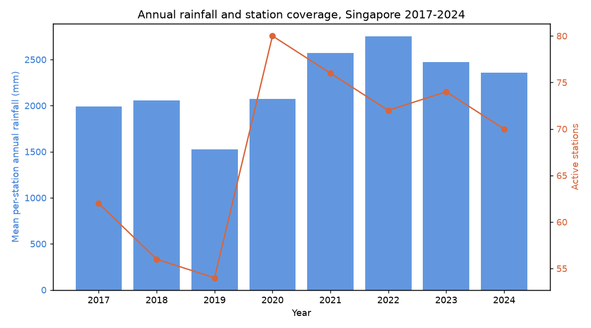

### 4.2 Change within a year (seasonal cycle)

The year-by-month heatmap and the averaged monthly climatology show Singapore's
monsoonal structure, with the wetter Northeast-monsoon months (Nov–Jan) and the
inter-monsoon peaks:

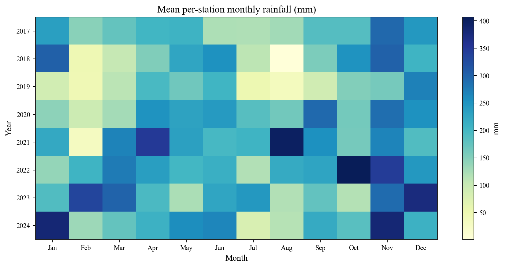

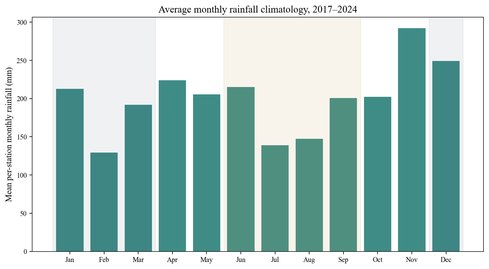

### 4.3 Change within a day (diurnal cycle)

Both the mean rainfall intensity and the probability that a 5-minute reading is
wet rise sharply to a **mid-afternoon peak (≈14:00–16:00 SGT)** and fall to an
overnight minimum — the classic tropical afternoon-convective pattern. For
example the wet-reading fraction climbs from ~1.1% at 23:00 to ~5.8% at 15:00.

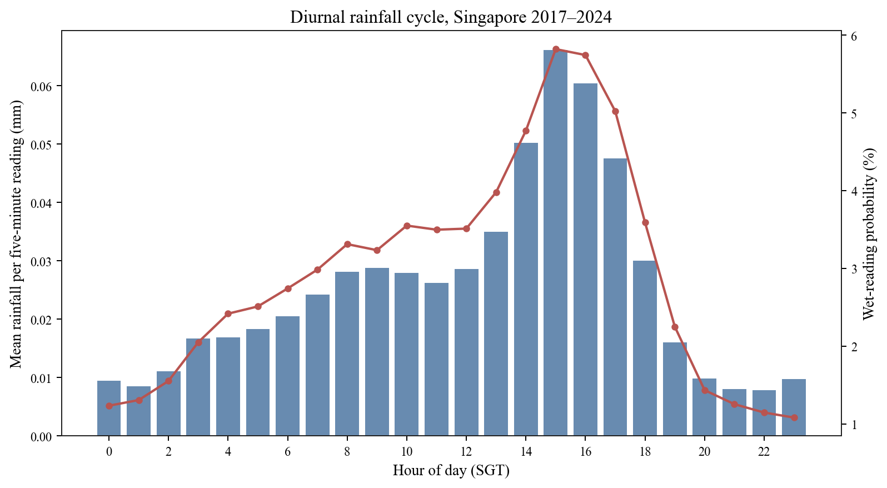

The pattern holds across monsoon seasons, with amplitude differences:

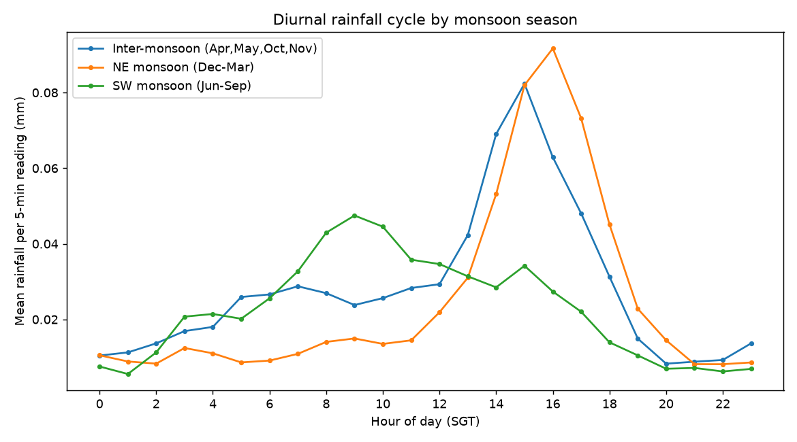

### 4.4 Spatial pattern

Rainfall is spatially uneven across the island; mapping each station's average
annual total and ranking the wettest/driest stations makes this concrete:

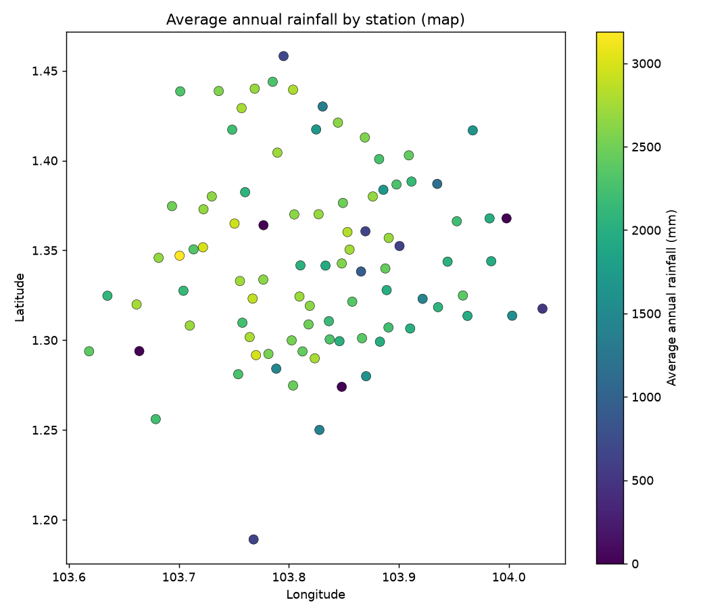

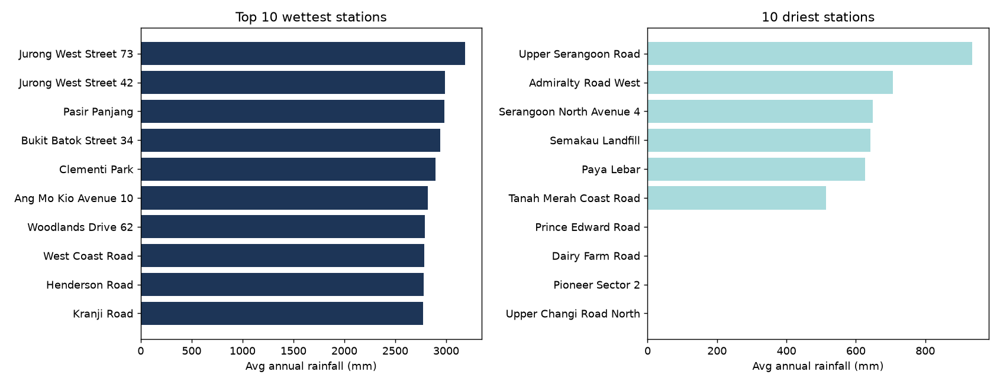

### 4.5 Extreme events

Counting **station-days with ≥ 50 mm** daily total, heavy-rain frequency peaked
in **2021 (875 station-days)**, matching the wet-year signal. A 2022 daily total
near 786 mm stands out as a probable extreme/outlier (flagged, not removed).

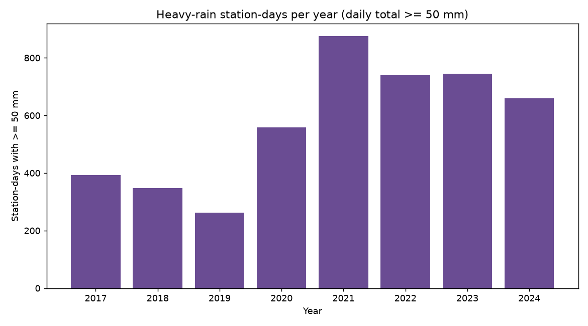

| Year | 2017 | 2018 | 2019 | 2020 | 2021 | 2022 | 2023 | 2024 |
|------|------|------|------|------|------|------|------|------|
| station-days ≥50 mm | 393 | 347 | 263 | 558 | **875** | 740 | 745 | 660 |

**Task 1 summary:** rainfall in Singapore is dominated by brief, intense
afternoon convective events; it varies seasonally with the monsoon regimes,
differs across the island spatially, and shows clear interannual swings (dry
2019, wet 2021–22) in both mean totals and heavy-event frequency.

---

## 5. Task 2 — Predicting P(rain > threshold in next 30 min)

### 5.1 Problem framing

The task requires the **rainfall threshold to be a user input** at prediction
time. Instead of training a separate model per threshold, we make the
**threshold a model feature**: for each `(station, 5-min timestamp)` we emit one
labelled example per candidate threshold (0.2, 1, 2, 5, 10 mm), with label `1`
if the true next-30-minute accumulation exceeds that threshold. A single model
then answers **any** threshold at prediction time, including unseen values.

### 5.2 Feature selection (leakage-free)

All features use only information available up to the prediction time
(`src/task2_features.py`):

- **Recent-rainfall context:** current 5-min reading, previous reading, rolling
  30/60/180-minute sums, and minutes-since-last-rain. (These dominate the signal
  — rain is strongly autocorrelated at short lead times.)
- **Cyclical time:** hour and month encoded as sine/cosine pairs (so hour 23 is
  adjacent to hour 0, December to January); weekend and NE/SW-monsoon flags.
- **Location/identity:** latitude, longitude, and station index.
- **The query threshold (mm).**

The label is the sum of the next six 5-minute readings; rows without a complete
30-minute future window are dropped so the label is exact. Feature engineering
is materialised once (`src/task2_build_features.py`) to avoid recomputing the
expensive per-station windows on every run.

### 5.3 Model and evaluation protocol

The graded model is a **Gradient-Boosted Trees (GBT) classifier** (Spark MLlib)
in a `Pipeline`: `StringIndexer` (station identity as a single indexed
categorical column, `maxBins ≥ 91` so the tree can split on it) →
`VectorAssembler` → GBT. Location is carried explicitly as lat/lon, so station
is **not** one-hot encoded (which bloated the feature vector and memory).

Evaluation uses a **temporal split** — train on **2017–2023**, test on
**2024** — reflecting real forecasting (a random split would leak future
information). Because rain is rare (train positive rate ≈ 1.9%), **accuracy is
uninformative** (~0.98 by always predicting "no rain"); we therefore report
**AUC-ROC** (ranking quality) and **AUC-PR** (the honest metric under heavy
class imbalance), overall and per threshold.

### 5.4 Results

**Full-data GBT** (train 2017–2023, 8.0 M rows after a memory cap; test 2024,
1.59 M rows):

| Metric | AUC-ROC | AUC-PR | Accuracy | F1 |
|--------|---------|--------|----------|----|
| Overall | **0.925** | **0.586** | 0.985 | 0.983 |

Per threshold, GBT vs a Logistic-Regression baseline:

| Threshold (mm) | GBT AUC-ROC | GBT AUC-PR | LogReg AUC-ROC | LogReg AUC-PR |
|----------------|-------------|------------|----------------|----------------|
| 0.2 | 0.904 | 0.660 | 0.879 | 0.557 |
| 1.0 | 0.905 | 0.577 | 0.874 | 0.500 |
| 2.0 | 0.895 | 0.505 | 0.865 | 0.441 |
| 5.0 | 0.898 | 0.398 | 0.857 | 0.346 |
| 10.0 | 0.905 | 0.302 | 0.861 | 0.253 |

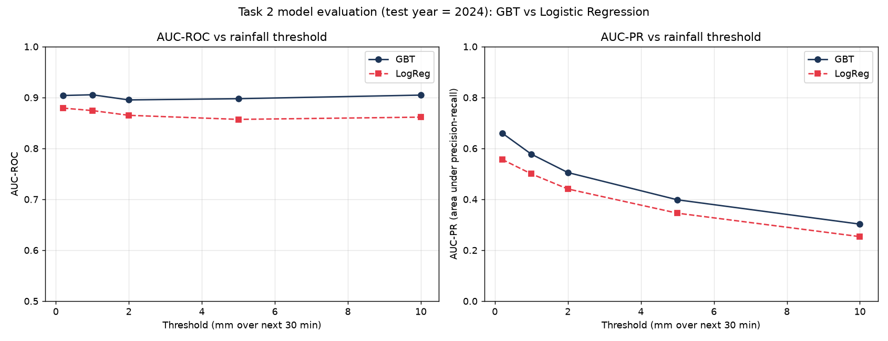

GBT beats the linear baseline at **every** threshold. AUC-ROC is stable (~0.90)
while AUC-PR declines as the threshold rises — expected, since heavy-rain
positives become progressively rarer.

### 5.5 Inference sanity check

Querying the saved model at real 2024 timestamps for station S77 confirms it is
context-sensitive and uses the threshold correctly:

| Context | recent-30-min rain | threshold | P(> threshold) |
|---------|--------------------|-----------|----------------|
| Dry afternoon | 0 mm | 1.0 | 0.04 |
| Heavy rain ongoing | ≈46 mm | 1.0 | **0.86** |
| Heavy rain ongoing | ≈46 mm | 5.0 | **0.70** |

Dry inputs → ~4%; wet inputs → 70–86%; and at the same wet moment the
probability correctly drops as the threshold rises. The trained pipeline is
saved to `models/rainfall_model/`.

---

## 6. Additional study — model × compute benchmark

We extended Task 2 into a two-axis study. Model definitions (`src/models/`) and
compute configurations (`src/compute/`) are modular registries, so one
orchestrator (`src/task2_train.py --model X --compute Y`) runs any combination,
logging train time, predict time, and AUC to CSV.

### 6.1 Model comparison (predictive error vs cost)

Seven retained models on their best configuration, ranked by AUC-PR:

| Model | Framework | Train (s) | Predict (s) | AUC-ROC | AUC-PR |
|-------|-----------|-----------|-------------|---------|--------|
| **GBT** | MLlib (CPU) | 279 | 8.2 | 0.925 | **0.586** |
| Random Forest | MLlib (CPU) | 173 | 8.4 | 0.902 | 0.560 |
| MLP | MLlib (CPU) | 321 | 8.0 | 0.921 | 0.557 |
| **LSTM** | PyTorch (GPU) | **75** | **0.4** | 0.915 | 0.476 |
| **TCN (1D-CNN)** | PyTorch (GPU) | **80** | **0.4** | 0.915 | 0.473 |
| Linear SVC | MLlib (CPU) | 44 | 5.4 | 0.875 | 0.468 |
| Logistic Regression | MLlib (CPU) | 28 | 4.9 | 0.897 | 0.436 |

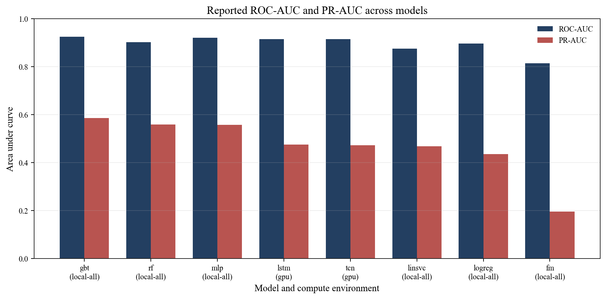

- **GBT is best overall** on both AUC-ROC and AUC-PR → the graded choice.
- The non-linear models (GBT, MLP, RF) and the deep sequence models (LSTM, TCN)
  cluster at the top on AUC-ROC (~0.90–0.925), while the linear models trail.
- The **LSTM/TCN match the best MLlib models on AUC-ROC despite training on ~20×
  less data** (400 k sampled rows vs 8 M, bounded by 4 GB VRAM) and are by far
  the fastest (train ~75–80 s, predict 0.4 s) — the best accuracy-per-compute.
  Their lower AUC-PR is largely a data-quantity artefact (see §7). MLlib was the
  required library, so GBT is the graded model and the deep models are a
  supplementary comparison; Spark MLlib has no recurrent model and is CPU-only,
  so the GPU cannot accelerate it.

### 6.2 Compute-configuration comparison (speed)

The four MLlib models were re-run across the five Spark configurations on an
**identical ~1 M-row sample** so timing is comparable. Training time (s):

| Config (cores) | GBT | RF | LogReg | LinSVC |
|----------------|-----|----|--------|--------|
| local-all (16) | **64** | **42** | **13** | **27** |
| standalone-2×2 (4) | 109 | 76 | 24 | 41 |
| standalone-4×2 (8) | 86 | 51 | 20 | 37 |
| docker-2w (4) | 102 | 72 | 22 | 46 |
| docker-3w (6) | 82 | 59 | 20 | 39 |

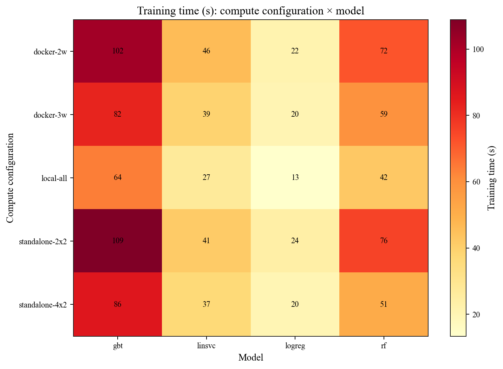

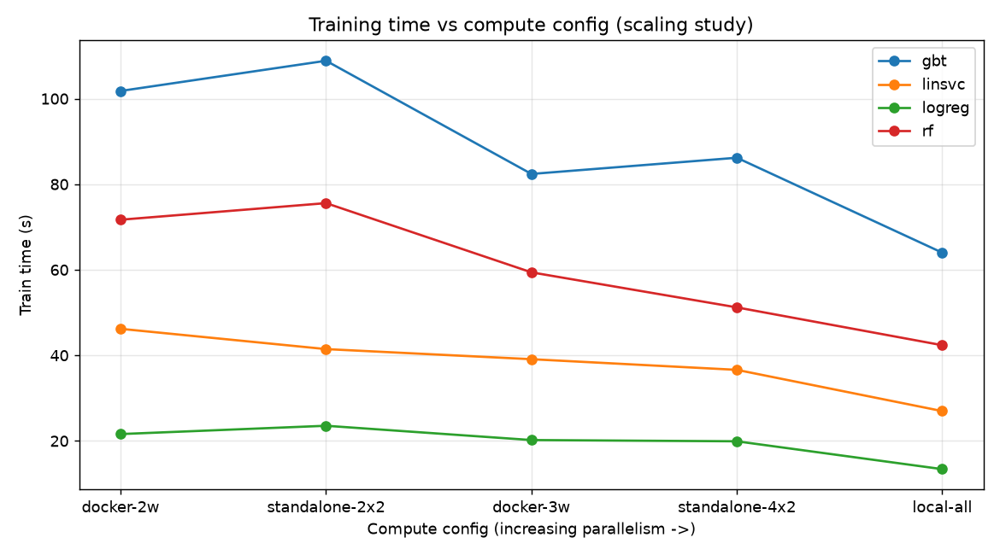

Findings (a textbook **scale-out vs scale-up** result):

- **`local[*]` is fastest** — all 16 cores in one JVM, no network/serialization
  overhead.
- Both cluster tiers are **slower on a single machine**, because distribution
  adds serialization/network/container overhead without adding hardware.
- **Within a cluster type, more workers = faster** (standalone 2×2→4×2:
  109→86 s; docker 2w→3w: 102→82 s for GBT) — real intra-cluster scale-out.
- At equal worker counts, **Docker ≈ Standalone** — containerisation adds little
  beyond the distribution itself.
- **AUC is essentially identical across all configs** (GBT ≈ 0.924 everywhere):
  the compute configuration changes **speed, not predictive error**.

**Implication:** on a single machine, more distribution adds overhead rather
than speed; genuine training speed-up would require multiple physical nodes.

---

## 7. Limitations, observations, and insights

- **Observation — recent rain dominates.** The 30-minute nowcast is driven
  mainly by the recent-rainfall features; the inference check (dry → 4%, wet →
  86%) shows the model has learned rainfall's short-term persistence.
- **Observation — imbalance matters more than accuracy.** With ~1.9% positives,
  accuracy is misleading; AUC-PR is the metric that actually separates the
  models and reveals the harder high-threshold cases.
- **Limitation — training-row cap.** The threshold-as-feature design multiplies
  rows 5× (~240 M total); to fit GBT in 24 GB we cap training at ~8 M rows.
  Fewer thresholds or fewer features are local options to use more data.
- **Limitation — single machine.** All compute tiers ran on one physical
  machine, so the cluster tiers demonstrate distributed deployment but cannot
  show true multi-node speed-up (which needs separate physical nodes). No
  cloud/HPC cluster was available.
- **Limitation — deep-model data parity.** The LSTM/TCN trained on a 400 k-row
  GPU-memory-bounded sample, not the full data, so their AUC-PR is understated
  relative to the MLlib models; a larger GPU would allow a same-data comparison.
- **Insight / future work.** A spatiotemporal model (ConvLSTM or graph-temporal
  network) ingesting all stations jointly could capture storm movement across
  the island; adding radar/reanalysis covariates and probability calibration
  would help operational use.

---

## 8. AI usage declaration

An AI coding assistant (within the Kiro IDE) was used, under the direction and
review of the group members, to help: scaffold the PySpark pipeline and the
modular model/compute registries; write and debug the cleaning, exploration,
training, benchmark, and cluster-launch code; diagnose runtime issues (e.g.
Python 3.12 `distutils`/`numpy` API changes, Spark executor-memory scheduling,
Docker container networking); and draft this report and the project
documentation. All modelling decisions, experiment design, executions on the
group's hardware, and interpretation of results were directed and verified by
the group members. Every number, table, and figure was produced by running the
pipeline on the actual dataset; no results were fabricated by the AI.

---

## 9. Reproducibility

Full instructions are in `README.md` and `RUNBOOK.md`. In brief, from the
project root:

```
python3 -m venv .venv && ./.venv/bin/pip install -r requirements.txt
./.venv/bin/python src/download_data.py            # 2017–2024 CSVs
./.venv/bin/python src/clean_data.py               # -> cleaned Parquet
./.venv/bin/python src/task1_explore.py            # Task 1 figures/tables
./.venv/bin/python src/task2_build_features.py     # Task 2 features
./.venv/bin/python src/task2_train.py --model gbt  # train + save GBT model
./.venv/bin/python src/task2_predict.py --station S77 --time "2024-06-15T14:00:00" --threshold 1.0
```

Benchmark study: `src/benchmark.py` (MLlib sweep), `src/task2_deep.py`
(GPU LSTM/TCN), `cluster/` (Spark Standalone), `docker/` (Docker cluster), and
`src/benchmark_plot.py` for the figures. Random seeds are fixed and the Spark
session time zone is pinned to `Asia/Singapore`. The trained GBT pipeline is in
`models/rainfall_model/` (with `model_metadata.json`); the deep models are
`models/rainfall_lstm.pt` and `models/rainfall_tcn.pt`.
